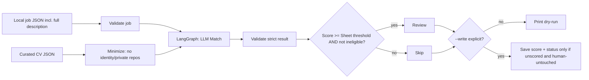

# AI Matching Architecture — v0.5

Sources of truth: `data/candidate_profile.json` holds confirmed professional history and candidate evidence; Google Sheets `Profile` provides operational threshold on writes; `Vacancies` is the tracker.

The model's raw JSON must contain `score`, `summary`, `matched_skills`, `missing_skills`, `critical_gaps`, `language`, `track` and `eligibility`. Every field is checked for presence and type before saving. No action tools are exposed to the model; it only returns a structured assessment.

Single-writer requirement: Google Sheets does not offer compare-and-swap updates via this simple values API. Avoid concurrent writes, and never treat the scoring step as user approval.
