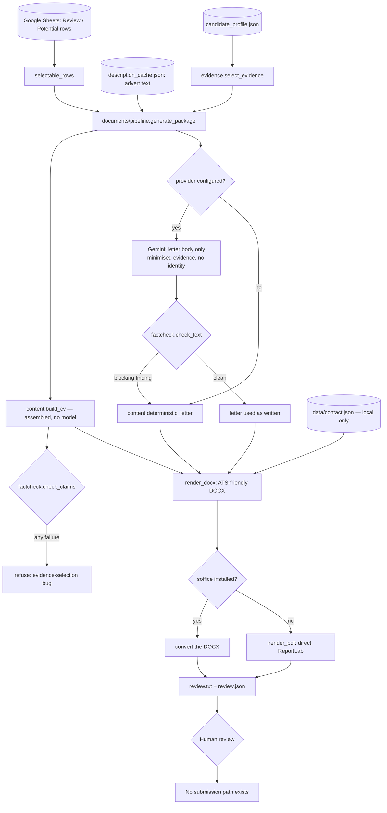

# Application documents — v0.13

Generates a tailored CV and cover letter for a vacancy already in the tracker.
Every output is a **draft**. Nothing here submits an application, uploads a
personal document or changes an approval.

## Architecture



### Files added

| File | Role |
|---|---|
| `documents/evidence.py` | Track-based evidence selection, language detection. Deterministic. |
| `documents/contact.py` | Local-only contact details. Never imported by the prompt builder. |
| `documents/content.py` | CV assembly, letter prompt, deterministic letter fallback. |
| `documents/factcheck.py` | Validates generated prose against the evidence allowlist. |
| `documents/render_docx.py` | ATS-friendly DOCX via python-docx. |
| `documents/render_pdf.py` | LibreOffice conversion when available, else ReportLab. |
| `documents/pipeline.py` | Orchestration + the review report. |
| `documents/drive.py` | Opt-in Drive upload. Inert without a new OAuth scope. |

Changed: `sheets.py` (`record_documents`, columns O/P only), `cli.py`
(`prepare`), `pyproject.toml` (`python-docx`, `reportlab`), `.gitignore`.

## CLI

```bash
uv run job-agent prepare --job-id ba:13644-229107-S          # preview, writes nothing
uv run job-agent prepare --status Review --limit 3            # preview several
uv run job-agent prepare --job-id <id> --files                # write DOCX + PDF locally
uv run job-agent prepare --job-id <id> --write                # + record refs in O/P
uv run job-agent prepare --job-id <id> --no-ai                # template letter, no model
uv run job-agent prepare --job-id <id> --language en          # force English
uv run job-agent prepare --job-id <id> --write --drive        # needs a new OAuth scope
```

Three write levels, deliberately separate:

| Flags | Effect |
|---|---|
| none | Preview only. No file, no spreadsheet change. |
| `--files` | DOCX + PDF + review report on disk. Spreadsheet untouched. |
| `--write` | Also records references in columns **O and P only**. |

`--overwrite-links` is required to replace a value already in O or P.

## Truthfulness

The CV is **assembled**, never generated: each line comes from a profile entry,
and `check_claims` refuses to continue if any line cannot be traced back. The
model writes only the cover-letter body, and `check_text` then looks for:

| Finding | Severity | Effect |
|---|---|---|
| Names Tinkoff / Sberbank | blocking | letter discarded |
| Implies employment as a developer | blocking | letter discarded |
| States years of experience | blocking | letter discarded |
| Claims a credential not in the profile | blocking | letter discarded |
| Names a private repository | blocking | letter discarded |
| References an excluded CV file | blocking | letter discarded |
| Employer or role not named | warning | reported |
| Hollow or exaggerated phrasing | warning | reported |
| Technology outside the evidence | warning | reported |

A blocking finding falls back to `deterministic_letter`, assembled from
evidence the same way the CV is. **There is always a truthful letter**, so a
fabrication can never be the thing that ships. A prompt injection inside an
advert is caught the same way: even if the model obeys it, the output is
rejected.

Never presented: SAP/ABAP (marked `not_evidenced`), the private `webserv` and
`greenroute-hn` repositories, the rejected bank employment, and
`Lebenslauf_Aslan_Isaev_Softwareentwickler.pdf`. The review report lists each
exclusion so the omission is visible rather than silent.

## Privacy and storage

- **Contact details live in `data/contact.json`** (git-ignored), loaded by
  `documents/contact.py` and inserted during rendering. `content.py` builds the
  prompt and never imports that module, so a phone number cannot reach the
  model by accident. A test asserts the prompt contains no name, email, phone,
  street or postcode.
- **The prompt carries `to_prompt_payload()` only**: education titles,
  evidenced skills with "project" or "cv/training" as their backing, public
  project names with their evidence points, non-software employment, languages,
  availability and the advert's requirements. No identity, no file names, no
  private repository.
- **Original CV PDFs are never read or sent.** The profile's `cv_variants` are
  treated as names to avoid, not as input.
- **Documents stay on disk** under `output/applications/<job-id>-<company>/`,
  which is git-ignored. Nothing is uploaded.
- **Column O/P hold `local: <path>`** when a file is local, with that prefix
  precisely because a filesystem path is not a link a recruiter could open.
  A real URL appears only after an explicit Drive upload.
- **Google Drive is opt-in and currently inert.** It needs the `drive.file`
  scope, which is not in `auth.SCOPES`; adding it invalidates `token.json` and
  requires an interactive re-authorisation. `drive.file` grants access only to
  files this application creates, never the rest of your Drive, and uploads are
  private with no link sharing. `job-agent prepare --drive` prints the four
  setup steps and refuses until they are done.
- The advert is passed as JSON data, and the system prompt states that
  instructions inside it are to be ignored.

## PDF: why two routes

`soffice` is not installed on this machine, so PDFs are rendered directly from
the same content model with ReportLab. Installing `libreoffice-writer`
switches to converting the DOCX instead — one source document, so the PDF
cannot drift from the editable file. No code change is needed; the converter is
detected per run and the review report says which route was used.

The DOCX is the editable deliverable either way. It is ATS-friendly by
omission: no tables, text boxes, columns, images, headers or footers, real
heading styles, one font, left-aligned, plain hyphen bullets.

## Manual review checklist

Before sending any draft:

1. **Contact block** — name, address, phone, email present and correct.
   `data/contact.json` must be filled in; until it is, the report says so.
2. **Employer and job title** — exactly as the advert spells them, including
   the legal form (GmbH, AG, KG).
3. **Recipient** — replace "Sehr geehrte Damen und Herren" with a named
   contact if the advert gives one.
4. **Company address** — add it to the letter; the generator does not invent one.
5. **Read the letter aloud.** A template letter is correct but plain; add one
   specific sentence about this employer.
6. **Check every factual sentence** against your own knowledge. The fact
   checker catches known fabrication patterns, not every possible error.
7. **Language** — if the document is German, check the project and employment
   descriptions. They come from the profile in English unless you add
   `evidence_points_de` / `background_de`; the report flags this.
8. **Unmet requirements** — the report lists what the advert asked for and the
   evidence does not cover. Decide whether to address or omit each one.
9. **Open questions** — settle anything the assessment could not verify.
10. **Project cautions** — the report repeats each project's caveat ("42
    educational project", "work in progress"). Do not overstate them.
11. **Page count** — CV 1–2 pages, letter 1 page. Trim in the DOCX if needed.
12. **Open both PDFs** and confirm they render as expected.
13. **Approval stays yours.** Generating documents does not change Status or
    Approval, and nothing is submitted.

## Testing with a real Review vacancy

```bash
# 1. See what is eligible.
uv run job-agent dashboard

# 2. Preview, no model call, no files, no spreadsheet change.
uv run job-agent prepare --status Review --limit 1 --no-ai

# 3. Add your contact details so the documents are complete.
cp data/contact.example.json data/contact.json && $EDITOR data/contact.json

# 4. Generate with Gemini writing the letter body; files on disk only.
uv run job-agent prepare --job-id <id> --files

# 5. Read the report and both documents.
cat output/applications/*/review.txt
xdg-open output/applications/*/Lebenslauf-*.pdf

# 6. Only if you want the references in the tracker:
uv run job-agent prepare --job-id <id> --write
```

A vacancy whose advert is not in the cache is skipped with that message; run
`job-agent daily --ai` first so the description is fetched.

## Known limitations

- Project and employment descriptions are English in the profile. A German CV
  shows them as-is and the report flags it; nothing is machine-translated.
- Python/OSMnx evidence is private-repository only, so it is excluded from
  documents. Making that repository public, or adding `cv_` evidence, would
  make Python presentable.
- No LibreOffice here, so PDFs are rendered rather than converted.
- The fact checker recognises known fabrication patterns. It is a safety net,
  not a substitute for reading the draft.
- Document generation is **not** part of the daily runner and will not be added
  there without your approval.
