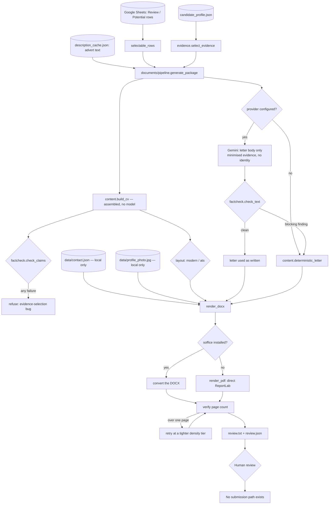

# Application documents — v0.13

Generates a tailored CV and cover letter for a vacancy already in the tracker.
Every output is a **draft**. Nothing here submits an application, uploads a
personal document or changes an approval.

## Architecture



### Files added

| File | Role |
|---|---|
| `documents/evidence.py` | Track-based evidence selection, language detection. Deterministic. |
| `documents/contact.py` | Local-only contact details. Never imported by the prompt builder. |
| `documents/content.py` | CV assembly, letter prompt, deterministic letter fallback. |
| `documents/factcheck.py` | Validates generated prose against the evidence allowlist. |
| `documents/layout.py` | The `modern`/`ats` styles, density tiers, page verification. |
| `documents/render_docx.py` | Style-aware DOCX via python-docx. |
| `documents/render_pdf.py` | LibreOffice conversion when available, else ReportLab; measures pagination. |
| `documents/pipeline.py` | Orchestration + the review report. |
| `documents/drive.py` | Opt-in Drive upload. Inert without a new OAuth scope. |

Changed: `sheets.py` (`record_documents`, columns O/P only), `cli.py`
(`prepare`), `pyproject.toml` (`python-docx`, `reportlab`), `.gitignore`.

## CLI

```bash
uv run job-agent prepare --job-id ba:13644-229107-S          # preview, writes nothing
uv run job-agent prepare --status Review --limit 3            # preview several
uv run job-agent prepare --job-id <id> --files                # write DOCX + PDF locally
uv run job-agent prepare --job-id <id> --write                # + record refs in O/P
uv run job-agent prepare --job-id <id> --no-ai                # template letter, no model
uv run job-agent prepare --job-id <id> --language en          # force English
uv run job-agent prepare --job-id <id> --write --drive        # needs a new OAuth scope
```

Three write levels, deliberately separate:

| Flags | Effect |
|---|---|
| none | Preview only. No file, no spreadsheet change. |
| `--files` | DOCX + PDF + review report on disk. Spreadsheet untouched. |
| `--write` | Also records references in columns **O and P only**. |

`--overwrite-links` is required to replace a value already in O or P.

## Truthfulness

The CV is **assembled**, never generated: each line comes from a profile entry,
and `check_claims` refuses to continue if any line cannot be traced back. The
model writes only the cover-letter body, and `check_text` then looks for:

| Finding | Severity | Effect |
|---|---|---|
| Names Tinkoff / Sberbank | blocking | letter discarded |
| Implies employment as a developer | blocking | letter discarded |
| States years of experience | blocking | letter discarded |
| Claims a credential not in the profile | blocking | letter discarded |
| Names a private repository | blocking | letter discarded |
| References an excluded CV file | blocking | letter discarded |
| Employer or role not named | warning | reported |
| Hollow or exaggerated phrasing | warning | reported |
| Technology outside the evidence | warning | reported |

A blocking finding falls back to `deterministic_letter`, assembled from
evidence the same way the CV is. **There is always a truthful letter**, so a
fabrication can never be the thing that ships. A prompt injection inside an
advert is caught the same way: even if the model obeys it, the output is
rejected.

Never presented: SAP/ABAP (marked `not_evidenced`), the private `webserv` and
`greenroute-hn` repositories, the rejected bank employment, and
`Lebenslauf_Aslan_Isaev_Softwareentwickler.pdf`. The review report lists each
exclusion so the omission is visible rather than silent.

## Privacy and storage

- **Contact details live in `data/contact.json`** (git-ignored), loaded by
  `documents/contact.py` and inserted during rendering. `content.py` builds the
  prompt and never imports that module, so a phone number cannot reach the
  model by accident. A test asserts the prompt contains no name, email, phone,
  street or postcode.
- **The prompt carries `to_prompt_payload()` only**: education titles,
  evidenced skills with "project" or "cv/training" as their backing, public
  project names with their evidence points, non-software employment, languages,
  availability and the advert's requirements. No identity, no file names, no
  private repository.
- **Original CV PDFs are never read or sent.** The profile's `cv_variants` are
  treated as names to avoid, not as input.
- **Documents stay on disk** under `output/applications/<job-id>-<company>/`,
  which is git-ignored. Nothing is uploaded.
- **Column O/P hold `local: <path>`** when a file is local, with that prefix
  precisely because a filesystem path is not a link a recruiter could open.
  A real URL appears only after an explicit Drive upload.
- **Google Drive is opt-in and currently inert.** It needs the `drive.file`
  scope, which is not in `auth.SCOPES`; adding it invalidates `token.json` and
  requires an interactive re-authorisation. `drive.file` grants access only to
  files this application creates, never the rest of your Drive, and uploads are
  private with no link sharing. `job-agent prepare --drive` prints the four
  setup steps and refuses until they are done.
- The advert is passed as JSON data, and the system prompt states that
  instructions inside it are to be ignored.

## PDF: why two routes

`soffice` is not installed on this machine, so PDFs are rendered directly from
the same content model with ReportLab. Installing `libreoffice-writer`
switches to converting the DOCX instead — one source document, so the PDF
cannot drift from the editable file. No code change is needed; the converter is
detected per run and the review report says which route was used.

The DOCX is the editable deliverable either way.

## The two CV variants

`--style modern` (default) or `--style ats`, or `--style both` to write both in
one run. The first style named keeps the plain filename and is the only one a
`--write` run records in the tracker; the other is written beside it with an
`-ATS` suffix.

| | `modern` | `ats` |
|---|---|---|
| For | a human reader at the employer | an applicant tracking system |
| Photo | optional, from `data/profile_photo.jpg` | never |
| Colour | dark navy name, headings and rules | near-black only |
| Tables | one borderless header table, when a photo is present | none |
| Body text | 10–10.5 pt | 10.5–11 pt |

`ats` is ATS-friendly by omission: no tables, text boxes, columns, images,
headers or footers; real heading styles, one font, left-aligned, plain hyphen
bullets. `modern` relaxes only the table and image rules, and only in the
header. Both consume the same `CvContent`, so a style is presentation and can
never add or drop a fact — a test asserts the two carry the identical set of
words.

## Technical skills: seven categories, ordered by the vacancy

The profile records skills as evidenced *bundles* — `"Java 17 / Spring Boot /
JPA / Security"` — because a single evidence list backs the whole bundle. A CV
reads better split, so each bundle is divided on `/` and every technology is
placed in one of seven categories:

| Category | From this profile |
|---|---|
| Programmiersprachen | Java 17, C, C++, PHP 8 |
| Backend & Frameworks | Spring Boot, JPA, Security, OOP |
| Systemprogrammierung & Netzwerke | Linux, Processes, HTTP, TCP Sockets, Configuration Parsing |
| Datenbanken | MariaDB, MySQL, SQL, PDO |
| KI & LLM | RAG, Embeddings, Ollama |
| DevOps & Werkzeuge | Docker, Docker Compose, NGINX, PHP-FPM, Bash, Git, GitHub |
| Tests | JUnit, MockMvc |

Splitting a bundle asserts exactly what the bundle asserts, decomposed. Every
fragment is printed **verbatim**: a category is a label on existing evidence,
never a competency, and nothing is translated.

**Nothing is dropped for being off-focus.** C and C++ appear on a Java, PHP or
AI CV too. What the vacancy changes is the order:

```
C/C++ vacancy    Systemprogrammierung & Netzwerke: Linux · Processes · HTTP · TCP Sockets · …
                 Programmiersprachen: C · C++ · PHP 8 · Java 17
Java vacancy     Backend & Frameworks: Spring Boot · JPA · Security · OOP
                 Programmiersprachen: Java 17 · PHP 8 · C · C++
AI vacancy       KI & LLM: RAG · Embeddings · Ollama
                 DevOps & Werkzeuge: Docker · …
```

A category's rank is the best relevance score among its technologies plus a
tie-breaking bonus from the vacancy's career track (`TRACK_EMPHASIS`). The
advert outranks the track emphasis deliberately: a PHP vacancy leads with
`Programmiersprachen: PHP 8 …`, because this profile's backend bundle is
Spring-centric and leading with it would put Java work first in a PHP
application.

Cue matching is word-boundary in both directions, so an advert asking for
"Javascript" never raises "Java", and a one-character technology ("C") must
match exactly — "Docker" cannot raise it.

**Only evidenced technologies are printed.** `Python / OSMnx / NetworkX /
Streamlit` rests solely on the private `greenroute-hn` repository, so it is
stripped and Python appears on no CV; emphasising Python for an AI vacancy
requires CV or public-repository evidence in the profile first. `SAP ABAP` is
`not_evidenced` and excluded the same way.

## The Bewerbungsfoto

Saved by the user at `data/profile_photo.jpg` (`.jpeg`/`.png` also accepted),
git-ignored, and loaded only by the renderers. It hangs off
`ContactDetails.photo_path` for the same reason the phone number does:
`content.py` builds every model prompt and does not import `contact.py`, so
neither can reach a prompt or a log. `--no-photo` omits it.

The image is **never generated, cropped or retouched**. The only operation is a
uniform scale to a fixed height. A photo that is too small, unreadable or not a
JPEG/PNG is refused with a reason; a landscape photo is used uncropped and the
report says there will be space beside it.

## One page, verified

A junior or trainee CV is expected on one A4 page. `render_cv_pdf` builds the
document, reads the page count back off the finished file and, if it spilled,
retries at a tighter density tier — `regular`, then `snug`, then `compact`.
It stops at the roomiest tier that fits one page *with slack at the bottom*,
because the DOCX is repaginated by Word in Calibri rather than by ReportLab in
Helvetica, and a page with no slack is the one that spills in the editable copy.

Tiers scale spacing, not legibility: body text gives up at most half a point
and never drops below 10 pt. If no tier wins a single page the roomiest layout
is restored — a balanced two-page CV beats unreadably small text — and the
report warns. It also warns when a last page is under 18% full, which is the
"accidental second page" the old output produced, and when a CV exceeds two
pages at all.

The review report prints the measurement for every style, e.g.
`CV layout 'modern' (compact spacing, reportlab): 1 page(s), last page 95% full
[tried regular:2p, snug:2p, compact:1p]`.

## Manual review checklist

Before sending any draft:

1. **Contact block** — name, address, phone, email present and correct.
   `data/contact.json` must be filled in; until it is, the report says so.
2. **Employer and job title** — exactly as the advert spells them, including
   the legal form (GmbH, AG, KG).
3. **Recipient** — replace "Sehr geehrte Damen und Herren" with a named
   contact if the advert gives one.
4. **Company address** — add it to the letter; the generator does not invent one.
5. **Read the letter aloud.** A template letter is correct but plain; add one
   specific sentence about this employer.
6. **Check every factual sentence** against your own knowledge. The fact
   checker catches known fabrication patterns, not every possible error.
7. **Language** — if the document is German, check the project and employment
   descriptions. They come from the profile in English unless you add
   `evidence_points_de` / `background_de`; the report flags this.
8. **Unmet requirements** — the report lists what the advert asked for and the
   evidence does not cover. Decide whether to address or omit each one.
9. **Open questions** — settle anything the assessment could not verify.
10. **Project cautions** — the report repeats each project's caveat ("42
    educational project", "work in progress"). Do not overstate them.
11. **Page count** — CV 1–2 pages, letter 1 page. Trim in the DOCX if needed.
12. **Open both PDFs** and confirm they render as expected.
13. **Approval stays yours.** Generating documents does not change Status or
    Approval, and nothing is submitted.

## Testing with a real Review vacancy

```bash
# 1. See what is eligible.
uv run job-agent dashboard

# 2. Preview, no model call, no files, no spreadsheet change.
uv run job-agent prepare --status Review --limit 1 --no-ai

# 3. Add your contact details so the documents are complete.
cp data/contact.example.json data/contact.json && $EDITOR data/contact.json

# 4. Generate with Gemini writing the letter body; files on disk only.
uv run job-agent prepare --job-id <id> --files

# 5. Read the report and both documents.
cat output/applications/*/review.txt
xdg-open output/applications/*/Lebenslauf-*.pdf

# 6. Only if you want the references in the tracker:
uv run job-agent prepare --job-id <id> --write
```

A vacancy whose advert is not in the cache is skipped with that message; run
`job-agent daily --ai` first so the description is fetched.

## Known limitations

- Nothing is machine-translated at render time. German documents use the
  profile's own `evidence_points_de`, `background_de`, `title_de` fields; where
  one is absent the English text is shown as-is and the report flags it. The
  fix is always a profile edit, never a translation in code.
- Python/OSMnx evidence is private-repository only, so it is excluded from
  documents. Making that repository public, or adding `cv_` evidence, would
  make Python presentable.
- No LibreOffice here, so PDFs are rendered rather than converted. This also
  means the DOCX page count cannot be verified locally; only the PDF's is. Open
  the DOCX once in Word or LibreOffice before sending.
- Python is evidenced only by a private repository, so it cannot be presented.
  That is the `not_evidenced`/private rule working, not a gap in the renderer.
- The fact checker recognises known fabrication patterns. It is a safety net,
  not a substitute for reading the draft.
- Document generation is **not** part of the daily runner and will not be added
  there without your approval.
