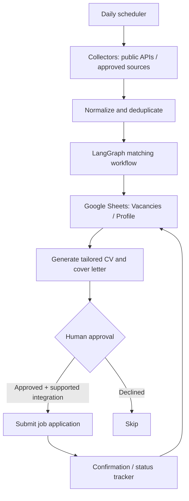
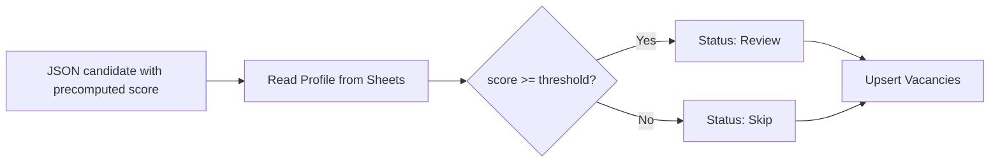

# Job Application Agent — Architecture

## Long-term pipeline

### Boundaries

- Collectors: separate adapters per job source; comply with provider rules and rate limits.
- Matching: hard filters (seniority, authorization, location, technology), then explainable AI score; 80% is *heuristic*, not probability of an offer.
- Repository: idempotent by stable Job ID, never overwrites human approval or application status on update.
- Submission: **not implemented in phase 1**. Later: explicit user approval, terms-compliant API or assisted browser flow, idempotency and positive confirmation before `Applied`.
- Secrets: local environment / secret store; never in Sheets or git.
- Scheduler: not implemented in phase 1; add systemd timer or cron when collector is implemented.

## Phase 1 working graph

The current graph does **not** search jobs, call an LLM, create CVs, or submit applications. It tests the real Sheets integration and decision preservation.

## Phase 2: read-only job discovery and append-only intake

- `collectors/arbeitnow.py`: fetches bounded pages from a public source, no API key.
- `job_filter.py`: applies hard title/location filters using current Google Sheet Profile.
- `GoogleSheetsRepository.append_discoveries`: one batch append of unknown IDs; no updates to existing rows, no fabricated score.
- `job-agent collect` defaults to a **dry run**; write requires `--write`.
- `LangGraph` still operates only on separately supplied **pre-scored** candidates. Real CV matching is not yet implemented.

## Phase 0.8: skill-based multi-source discovery

The seven fixed job titles are replaced by eleven configurable career tracks with
German and English query variants, searched round-robin across modular source
adapters that all return one normalized schema. See
`docs/SKILL_BASED_DISCOVERY.md` for the full diagram and rules.

New stages between discovery and matching:

- **Dedup** (`sources.deduplicate`): source-namespaced job id, then normalized
  URL, then a company/role/city fingerprint, checked against the sheet too.
- **Eligibility pre-screen** (`eligibility.py`): deterministic regex pass over the
  advert. Blocks only a mandatory current-enrolment requirement; every other hard
  condition becomes a verification question handed to the model.
- **Assessment cache** (`cache.py`): skips a model call when the advert text, the
  minimized evidence and the system prompt are all unchanged.

Boundaries that did **not** change: the Sheets `Profile` tab remains canonical for
operational settings, an existing row is still only ever updated at C:L or I:M (plus
optional T) and only while untouched by a human, scores are never invented, and no
submission capability exists.
