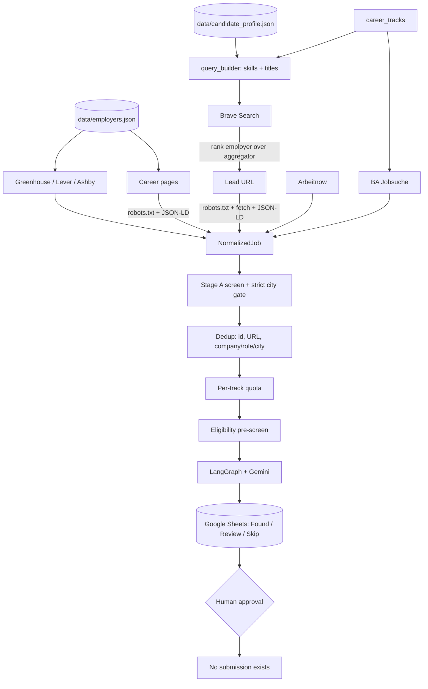

# Multi-source employer discovery — v0.9

Adds employer-direct discovery (ATS boards and career pages) and web-search
discovery to the skill-based pipeline in `SKILL_BASED_DISCOVERY.md`. Everything
that document describes still holds: Stage A screening, the eligibility
pre-screen, LangGraph matching, the 80% threshold, Google Sheets write
protection, human approval, and no submission path.



## Priority 1: employer-direct discovery

### ATS board adapters

| Platform | Endpoint | Status |
|---|---|---|
| Greenhouse | `boards-api.greenhouse.io/v1/boards/{board}/jobs?content=true` | Shape confirmed against live boards |
| Ashby | `api.ashbyhq.com/posting-api/job-board/{board}` | Shape confirmed against a live board |
| Lever | `api.lever.co/v0/postings/{board}?mode=json` | Built to the documented shape; **no live board was reachable to confirm it** |

All three are whole-board sources: no keyword search exists, so the adapter
returns every posting in the configured cities and the pipeline's Stage A
screen and per-track quota select from them. They are `single_shot`, meaning
one HTTP request per board per run regardless of how many queries are planned.

A posting's career track is **inferred from its title** (`career_tracks.infer_track`),
because there is no query to inherit one from. That keeps the per-track quota
meaningful across every source.

### The employer registry

`data/employers.json` is the only list of employers the agent may query. There
is no board discovery and no token guessing: an employer is contacted only when
it appears there with `enabled: true`.

```bash
uv run job-agent employers            # show the registry
uv run job-agent employers --probe    # re-check each board, read-only
uv run job-agent employers --probe --all
```

Each entry records its `verified_on` date and the counts actually observed, so
the file states evidence rather than hope. `--probe` re-measures and prints what
each board publishes now; adjust `enabled` from that output.

**What the verification found (2026-11-21).** Across **1,425 postings on 13 live
boards, 4 were in Frankfurt, Stuttgart or Heilbronn** and 34 including
remote-Germany. The Greenhouse/Lever/Ashby ecosystem is Berlin- and
Munich-centric. Large employers in your three cities overwhelmingly run their
own portals or SAP SuccessFactors. Two consequences:

- `ALLOW_REMOTE_GERMANY=true` roughly multiplies the usable yield by eight.
- Priority 1 alone cannot cover these cities, which is why career pages and
  search discovery exist.

Not every employer uses one of these platforms, and the registry does not
pretend otherwise: unreachable employers are simply absent from it.

### Career pages

`CareerPageSource` reads **only** schema.org `JobPosting` JSON-LD — the
structured data employers publish so job search engines can index them. The
company, title, location, description and `validThrough` all come from that
data, never from guessing at page text. A page without it yields nothing and
the run reports why.

Access rules are enforced in code:

- `robots.txt` is consulted for every URL, including each followed link. A
  disallowed URL is not fetched; an unreadable `robots.txt` means no fetch.
- A `Crawl-delay` longer than the local default raises the adapter's interval.
- Links are followed same-host only, one level from the configured index page,
  bounded by `max_links`.
- No login, cookie wall, CAPTCHA or anti-bot measure is touched. Nothing is
  submitted.

Add an employer under `career_pages` in the registry after checking those two
preconditions. The shipped entry is a disabled placeholder — no endpoint is
invented. **JavaScript-rendered portals (most SuccessFactors and Workday
instances) publish no JSON-LD and are not supported**; the adapter reports that
rather than scraping around it.

## Priority 2: Brave Search

```bash
BRAVE_SEARCH_API_KEY=...        # https://brave.com/search/api/
JOB_SOURCES=ba,arbeitnow,greenhouse,ashby,brave
```

Discovery is a three-step sequence, and the order is the point:

1. **Search.** Queries are built from the candidate's *verified evidence* as
   well as the career-track titles. `job-agent search-queries` shows them.
2. **Rank.** Employer sites and ATS hosts first, aggregators last and skipped
   by default. A search hit is a lead, not a vacancy.
3. **Verify at the source.** The employer's own page is fetched (robots-checked)
   and its `JobPosting` JSON-LD is read. No structured data, or a `validThrough`
   in the past, means the lead is dropped. This is how current availability is
   confirmed instead of inferred from a stale snippet.

Query generation mixes two kinds, alternating per track so a run is never just
a list of job titles:

```
[title] ai_engineering  "LLM Engineer" Frankfurt am Main Karriere
[skill] ai_engineering  RAG Embeddings "LLM Engineer" Frankfurt am Main Karriere
```

Skill keywords are derived from `data/candidate_profile.json` and exclude
anything marked `not_evidenced` — SAP ABAP is searched by *title* but never as a
skill claim. A skill evidenced only by a private repository (Python/OSMnx) is
still searched for: searching is not a claim, and `ai_matching.py` filters that
evidence out of the prompt independently.

Aggregators are classified in `query_builder.py`
(`AGGREGATOR_DOMAINS`, `ATS_DOMAINS`). An ATS host counts as employer-direct,
because a posting on `jobs.lever.co` *is* the employer's own posting.

### API costs and limits

| Item | Value |
|---|---|
| Brave free tier | 1 request/second, 2,000 queries/month, no card |
| Queries per run | `BRAVE_MAX_QUERIES`, default 8 |
| Monthly cost at one run/day | ~240 of the 2,000 free queries |
| Employer pages fetched per run | `BRAVE_MAX_VERIFICATIONS`, default 12 |
| Rate limiting | Enforced in `ratelimit.py`, not left to the caller |
| Gemini | Billed per token, capped at `--max-matches` calls per run |
| Ollama | Free, local |

The one-request-per-second limit is enforced by `RateLimiter`, so the adapter
cannot burst even if misconfigured. `job-agent daily` prints the Brave source's
counters (`api_calls`, `pages_verified`, `postings_confirmed`,
`no_jobposting_data`, `aggregators_skipped`) so each run's cost is visible.

## Priority 3: filtering

Unchanged from v0.8 and still enforced for every new source:

- Eleven career paths, German and English terms, **"Junior" never required**.
- Senior-only titles excluded. v0.9 also drops `staff` and people-management
  compounds (`engineering manager`, `product manager`, …) after live results
  surfaced them — but *not* a bare "manager", because "Prozessmanager IT" and
  "Projektmanager" are legitimate transferable fits.
- Werkstudent and other enrolment-only roles excluded, at the title *and* in
  the advert text. Internships without an enrolment requirement are kept.
- Mandatory qualifications detected by `eligibility.py` and handed to the model
  as verification questions; unknown is never scored as a failure.
- Projects are evidence, never employment: `minimal_llm_profile` keeps
  demonstrated, transferable and unknown strictly separate.
- Deduplication across **all** sources by job id, normalized URL, then
  company/role/city fingerprint, and against the rows already in the sheet.
- Unchanged vacancies are cached; only the model call is skipped, and the advert
  is re-read so an edit is noticed.
- Per-source rate limits in `ratelimit.py`; `robots.txt` honoured for every
  ordinary web page fetched.

## Priority 4: what did not change

Gemini remains the default matching provider. `providers.py` holds the registry;
`CompletionProvider` is the entire contract:

```python
class MyProvider:
    def complete(self, messages: list[dict[str, str]]) -> Mapping[str, Any]: ...
```

Adding Anthropic or OpenAI means registering a factory there. No collector, no
filter and no pipeline code changes — `tests/test_providers.py` asserts that the
discovery modules contain no provider reference at all.

```bash
uv run job-agent providers    # providers, readiness and costs
```

Retained unchanged: LangGraph matching, Google Sheets integration, the existing
candidate profile, the 80% Review threshold read from the Sheets `Profile` tab,
and the human-approval requirement. **No application is ever submitted, and no
code path exists to submit one.**

## CLI reference

```bash
uv run job-agent employers                 # registry (offline)
uv run job-agent employers --probe         # re-check boards, read-only
uv run job-agent search-queries --limit 12 # queries from your profile (offline)
uv run job-agent providers                 # LLM providers and costs (offline)
uv run job-agent tracks                    # career tracks and today's plan (offline)

uv run job-agent daily                                  # dry run, all sources
uv run job-agent daily --sources greenhouse,ashby       # employer-direct only
uv run job-agent daily --remote-germany                 # include remote-Germany
uv run job-agent daily --sources brave --ai             # search + scoring, no write
uv run job-agent daily --ai --write                     # the real daily run
```

## Known limitations

- **The Lever adapter is unverified.** None of the board handles tried existed,
  so it has never run against live data. Confirm a handle before enabling it.
- **The three target cities are thinly covered by ATS boards** (4 of 1,425
  postings). Remote-Germany and the search adapter are where the yield is.
- **Career pages need JSON-LD.** JavaScript-rendered portals cannot be read.
- **Brave results are only as good as the queries**, and the free tier is 2,000
  queries/month. A lead without structured data is dropped, so some genuine
  vacancies will be missed — a miss is preferred to an invented vacancy.
- `career_page` and `brave` rows are **not resumed** from the sheet: their URLs
  can be any host, so a stored URL is never trusted for a refetch. They are
  re-discovered instead.
- The content fingerprint is coarse: an employer with two identical openings in
  one city will see one suppressed. It only suppresses a *discovery*.
- Scores remain advisory heuristics. Single writer only. No submission path.

---

# v0.10 — free sources on by default, evidence-weighted tracks

## Why the daily run only used BA and Arbeitnow

Two independent causes, both in configuration rather than in the adapters:

1. **`JOB_SOURCES` was absent from `.env`**, so the code default
   `("ba", "arbeitnow")` applied. The five enabled boards in
   `data/employers.json` were unreachable because their *source family* was
   off — the registry was never consulted.
2. **`config.py` dropped `greenhouse` and `lever` whenever `GREENHOUSE_BOARDS` /
   `LEVER_COMPANIES` were empty**, looking only at the env overrides and never
   at the registry. So even with the family enabled, Greenhouse was removed
   despite three verified boards.

A third factor suppressed whatever survived: **`ALLOW_REMOTE_GERMANY` defaulted
to `false`**, and the verified boards publish 0 postings in the three cities
against 34 including remote-Germany.

Fixes:

- `config.FREE_SOURCES` is the new default: `ba, arbeitnow, greenhouse, lever,
  ashby, career_page`. Every one is free and needs no account. **Brave is
  deliberately excluded** — it needs an API key, so it stays opt-in via
  `JOB_SOURCES` even when a key exists.
- Board availability is decided only in `build_sources`, which merges the
  registry with the env overrides and skips a platform that ends up with no
  board. `lever` and `career_page` therefore self-skip while unconfigured.
- `ALLOW_REMOTE_GERMANY` defaults to `true`. `--no-remote-germany` restores the
  strict three-city behaviour for one run.
- `interleave_by_source` runs before the per-track quota and the `max_new` cut,
  so a large feed cannot take every slot by virtue of being queried first.

## Per-source funnel

`job-agent daily` now prints where each source's postings go, so this question
is answerable from a report rather than a debugging session:

```
Per-source funnel (fetched -> kept by Stage A; dropped by city/title):
  arbeitnow      27 ->    1   city=0 title=26
  ashby          27 ->    4   city=0 title=23
  ba             73 ->   39   city=13 title=21
  greenhouse      7 ->    0   city=0 title=7
```

Read it as a funnel: Greenhouse fetched only 7 city-relevant postings out of
669 on its three boards, and all 7 were Credit Risk Manager, Account Executive
and Fachkraft für Arbeitssicherheit — correctly dropped. `by_source` on the
next line counts **new rows only**: a posting already in the tracker appears
under `previously found/unscored` instead.

## Track priorities from profile evidence

`CareerTrack.priority` (1–3) now sets each track's share of both the search
budget and the result quota. It is derived from what
`data/candidate_profile.json` evidences, never from how attractive the titles
sound:

| Priority | Tracks | Evidence |
|---|---|---|
| 3 | `ai_engineering`, `python_automation`, `java_backend`, `php_web`, `cpp_systems`, `linux_devops`, `software_generalist` | DokuChat (RAG/Ollama/embeddings), Python/OSMnx/NetworkX, Pizza In Progress (Spring Boot/JPA), php-login-system, minishell/Cub3D/webserv, Inception (Docker/NGINX) |
| 2 | `data_engineering` | SQL/MariaDB evidenced; no ETL or BI tooling evidence |
| 1 | `sap_abap`, `it_consulting`, `graduate_entry` | Not evidenced, or transferable only |

At a 33-query budget the share becomes roughly 3–5 queries for each
priority-3 track, 3 for data engineering and 2 each for the priority-1 tracks.
`weighted_order` puts **every** track in the first pass and restricts only the
later passes, so a small budget still reaches all eleven — prioritising must
not hide the SAP or trainee routes completely.

`career_priority`, the discovery rank, was also corrected: it placed SAP/ABAP
above AI, Python and automation titles, contradicting the profile.

## Eligibility false positives on Trainee roles

Verified against live BA adverts: of 4 postings the pre-screen blocked, **3 were
false positives**. The cause was matching `werkstudent\w*` anywhere in the
advert, while German postings routinely list

> "Idealerweise erste Erfahrung durch Praktika oder **Werkstudenten**-Tätigkeit"

as *desirable prior experience*. Two "Trainee IT (m/w/d)" roles and a
"Praktikum Forensic" role were rejected on that basis.

`eligibility.enrolment_requirement` is now clause-level and needs the enrolment
term framed as a requirement **for this role**:

- A bare `Werkstudent` in the **title** is decisive; in the body it must appear
  as `als Werkstudent`, `Werkstudent (m/w/d)` or `… suchen … Werkstudent`.
- An enrolment term in a clause that also mentions experience (`Erfahrung`,
  `Tätigkeit`, `beispielsweise`, `idealerweise`, `von Vorteil`, `Anschluss`,
  `bereits`, `z. B.`) is prior experience and does not block.
- Otherwise it blocks only with obligation wording (`erforderlich`,
  `Voraussetzung`, `Nachweis`, `vorzulegen`, `muss`, `required`, `must`) or
  applicant framing (`Du bist … immatrikuliert`).
- The blocker now **quotes the clause it relied on**, so a block is auditable.

Re-run over the same 27 live adverts: **4 blocks → 1**, and that one's title
literally reads "Praktikum / Werkstudent IT-Beratung Public Sector (w/m/d)".

## Unchanged

Gemini remains the matching provider. No paid API is required or enabled. All
verification in this round was dry-run and read-only: no Google Sheets write,
no application, no schedule activated.
