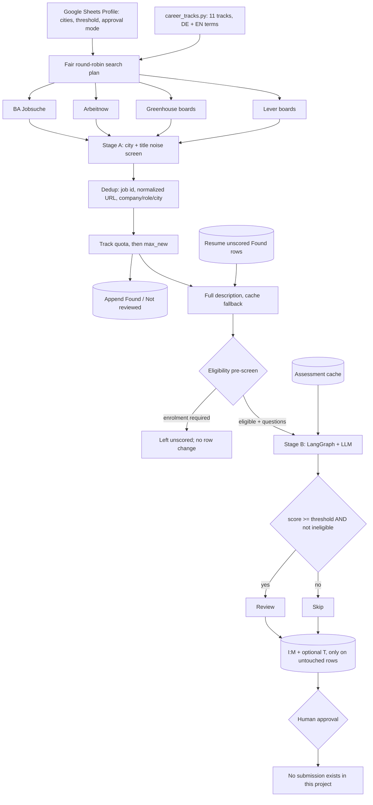

# Skill-based discovery — v0.8

Replaces v0.7's seven fixed job titles with configurable career tracks across
several job sources.



## Career tracks

Eleven tracks in `src/job_agent/career_tracks.py`, each with German and English
query variants. Ten are the requested categories; `software_generalist` holds
the generic titles ("Software Engineer", "Anwendungsentwickler", "Backend
Developer") that belong to no single technology.

No query contains the word "Junior". Entry-level roles are routinely advertised
without it, and requiring it was the main reason v0.7 missed openings.

```bash
uv run job-agent tracks                      # all tracks and today's plan
uv run job-agent tracks --tracks ai_engineering,python_automation
uv run job-agent daily --tracks php_web      # restrict one run
```

`CAREER_TRACKS=ai_engineering,php_web` in `.env` sets a persistent default.

### Fair quotas

Two separate fairness mechanisms:

1. **Search budget.** `search_plan` hands out queries round-robin, one per
   track per round, with a date-derived offset. A budget below the track count
   still rotates across days instead of permanently favouring the first track.
2. **Result quota.** `apply_track_quota` keeps at most `ceil(max_new / tracks
   present today)` postings per track, so the large volume of "Praktikum"
   listings cannot consume the whole run. The divisor counts tracks that
   actually returned results, not every enabled track — otherwise a quiet day
   would shrink the quota to one posting and discard good hits.

## Stage A: broad candidate discovery

`job_filter.screen_title` is a *noise* filter, not a fit assessment. Ambiguity
resolves to keep. It drops only:

| Dropped | Why |
|---|---|
| `senior`, `sr.`, `lead`, `principal`, `staff`, `architect`, `head of`, `Leiter`, `erfahren` | Requires extensive commercial expertise |
| "7 Jahren Erfahrung" in the title | Same |
| `Werkstudent`, `working student`, `studentische Hilfskraft` | Needs enrolment proof the candidate cannot supply |
| No technical/IT token at all | Full-text search noise |

Internships are **kept** at this stage; whether they demand enrolment is
decided from the advert body, not guessed from the title.

City matching stays strict (`_exact_city`): suburbs such as "Bischofsheim bei
Frankfurt" and Frankfurt (Oder) are rejected. A hit is accepted when it matches
*any* configured city, because BA searches with a radius and a Stuttgart query
legitimately returns a Heilbronn posting. Set `ALLOW_REMOTE_GERMANY=true` to
also accept remote-Germany postings from the board sources.

## Eligibility pre-screen

`eligibility.py` runs deterministically over the advert before any model call.

- **Blocks** exactly one condition: a mandatory current-enrolment requirement.
  Such a job is left as an unscored `Found` row — writing a 0 would be a
  fabricated score, and the human should still see the listing.
- **Everything else becomes a question** passed to the model: German above B2,
  five or more years of experience, a security clearance, a citizenship or
  permit condition, a driving licence, a mandatory degree. An absent statement
  is unknown, never a proven failure.

## Stage B: evidence-based matching

The prompt now separates HARD from DESIRABLE requirements and three evidence
classes (demonstrated / transferable / unknown). The model returns three extra
fields beyond v0.7: `transferable_skills`, `mandatory_unmet` and
`unknown_requirements`. All three are optional on read, so a cached v0.7
assessment still loads.

Unchanged: the 80% threshold comes from the Sheets `Profile` tab, the advert
travels as JSON data and never as an instruction, and only minimized evidence
leaves the machine — no name, no contact details, no private repository.

## Sources

| Source | Search | Description | Status |
|---|---|---|---|
| `ba` | Server-side, per term and city | Separate detail call | Working, unofficial endpoint |
| `arbeitnow` | Local, over a bounded page window | Embedded in the listing | Working, public API |
| `greenhouse` | Local, one fetch per board | Embedded (`content=true`) | **Unverified**: needs board tokens |
| `lever` | Local, one fetch per board | Embedded, all list blocks | **Unverified**: needs company handles |

Greenhouse and Lever make no requests until you configure a board:

```bash
JOB_SOURCES=ba,arbeitnow,greenhouse,lever
GREENHOUSE_BOARDS=examplecorp,anothercorp
LEVER_COMPANIES=examplecorp
```

Only the documented JSON endpoints are called. No career-page HTML is scraped,
no login or CAPTCHA is touched, one request per board per run, with backoff.
Confirm each board's terms before enabling it.

## Deduplication

Three keys, in order of trust: source-namespaced job id (`ba:<refnr>`,
`greenhouse:<board>-<id>`), normalized URL (tracking parameters, `www.`,
scheme and trailing slash removed), then a company/role/city fingerprint for
the same advert republished elsewhere. Candidates are also checked against the
job ids and URLs already in the spreadsheet.

The fingerprint is coarse by design: an employer running two identical openings
in one city would see one suppressed. It only ever suppresses a *discovery* and
never merges rows that already exist.

## Cache

`data/description_cache.json` (git-ignored, mode 600) stores each advert and
its assessment, keyed by job id and validated against a SHA-256 of the advert
text plus a fingerprint of the minimized evidence *and* the system prompt.
Editing the profile or the prompt invalidates every entry, because an old score
no longer reflects what the model would now say.

The advert is re-read on each run — that is cheap and bounded by `--max-detail`
— so an edited advert is detected. The model call is what the cache prevents.
When a fetch fails, or a board source cannot re-describe a posting resumed from
the sheet, the cached text is used as a fallback.

## Budgets and error handling

| Flag | Default | Caps |
|---|---|---|
| `--max-searches` | 33 | Source queries (1..120) |
| `--per-search` | 10 | Results requested per query |
| `--max-new` | 12 | New spreadsheet rows |
| `--max-matches` | 6 | Model calls |
| `--max-detail` | 20 | Description fetches |

- A failing source is isolated; the run continues on the others. Only when
  *every* query on *every* source fails does the run abort, before any write.
- A failed description leaves the row `Found`, to be retried tomorrow.
- The first model failure stops the remaining model calls: a 429 or an auth
  error will repeat for every job and each attempt may be billable.
- Errors are structured (`[stage] Kind (source/reference): detail`) and never
  carry a request body, a response body or an API key.
- Retries use exponential backoff with full jitter, on transient statuses only
  (408, 425, 429, 5xx). A 401/403/404 is never retried. No retry wraps a Sheets
  write: the values API has no compare-and-swap, so a blind retry could
  duplicate a row.

## Spreadsheet compatibility

Columns A:S keep their exact meaning. v0.8 adds one **optional** column T,
`Eligibility`, so the verdict is filterable instead of buried in prose:

```bash
uv run job-agent migrate-schema            # dry run, shows what would change
uv run job-agent migrate-schema --write    # writes T1 only
```

A 19-column sheet stays fully supported and nothing is written to T until you
migrate. `validate_schema` accepts exactly 19 or exactly 20 columns and aborts
on anything else, because a shifted column would mean writing a score over
somebody's approval. Column T is written as its own single-cell update: one
contiguous `I:T` range would overwrite Approval, the CV links, the applied date
and Notes.

Unchanged guarantees: an existing row is updated only at C:L (upsert) or I:M
(assessment), only when it is still `Found` / `Not reviewed` / unscored, and
never when a human has touched it.

---

# v0.11 — source fairness, evidence-based tracks, the Potential band

## The source-allocation bug

Reported split: **BA 28, Arbeitnow 1, Ashby 1** out of 30 selected.

`interleave_by_source` gives every source a *turn*, which is not the same as a
cap. With 40 BA candidates against 1 Arbeitnow and 1 Ashby, the two small
buckets empty after the first round and BA fills all 28 remaining slots. The
mechanism was reproduced exactly in a unit test.

Worth being precise about what this was and was not: **the 28/1/1 split was
supply-limited, not an unfair draw.** Arbeitnow and Ashby got every candidate
they had. No allocation rule can raise a source's count when it has nothing
left to offer; it can only lower the large one's.

`apply_source_quota` caps each source's *absolute* contribution, which is the
part that can be controlled:

```bash
SOURCE_DEFAULT_SHARE=0.5          # no source may take more than half of --max-new
SOURCE_SHARES=ba:0.4,ashby:0.3    # per-source overrides
SOURCE_FILL_LEFTOVER=false        # true = fill the budget, dropping the cap
```

```
40 BA / 1 Arbeitnow / 1 Ashby, --max-new 30
  no cap (v0.10)       ba 28, arbeitnow 1, ashby 1   (30 rows)
  share 0.5            ba 15, arbeitnow 1, ashby 1   (17 rows)
  share 0.5 + fill     ba 28, arbeitnow 1, ashby 1   (30 rows)
20 BA / 12 Arbeitnow / 9 Ashby, --max-new 30
  share 0.5            ba 11, arbeitnow 10, ashby 9  (30 rows)
```

Two rules keep the cap from doing harm:

- **A lone contributing source is never capped.** Halving the only source's
  candidates would discard work for no fairness benefit.
- **A share of 0 still leaves one slot.** A cap must not silence a source.

**Global deduplication is unchanged and still runs first**, over every source
at once, before ranking and before any fairness rule — so a cap can never
resurrect a posting another source already supplied.

The more valuable half of the fix is on the **model budget**: the scoring queue
is now interleaved by source. Previously a queue of resumable BA rows consumed
every `--max-matches` call before an employer-board posting was reached.

## The track-classification bug

Reported: Cosuno postings labelled `python_automation` (2) and **`cpp_systems`
(2)**, with no C or C++ anywhere in them.

Cause, in `daily_pipeline.py`: `infer_track(hit.role) or query.track`. For a
source with no keyword search, `query.track` belongs to an unrelated planned
query. "Implementation Consultant" and "GTM & Growth Engineer" matched no
track, so they inherited whichever track the day's first query carried — that
day, `cpp_systems`. Separately, `ai` and `ki` were in the stopword list, so an
AI title could never reach `ai_engineering`.

| Title | v0.10 | v0.11 |
|---|---|---|
| AI Automation Engineer | `python_automation` | `ai_engineering (ai)` |
| Founders Associate – AI & Automation | `python_automation` | `ai_engineering (ai)` |
| Implementation Consultant (m/w/d) | `cpp_systems` ✗ | `it_consulting (implementation)` |
| GTM & Growth Engineer | `cpp_systems` ✗ | `unclassified` |

Changes:

- `classify_title` returns a `TrackMatch` carrying **the words the label rests
  on**, and `confident` is false without them.
- Classification uses `_TRACK_SIGNALS`, distinctive vocabulary written per
  track, rather than tokens scraped from search-box phrasing.
- `ai` and `ki` are signals, not stopwords.
- An unidentifiable title becomes `unclassified` and is **never** given a
  track from an unrelated query. The run reports those titles separately.

Ties break towards the higher-priority track, then canonical order, so results
are stable. `job-agent daily` prints every inferred label with its evidence.

## Status bands

| Band | Condition | Status |
|---|---|---|
| Hard failure | `eligibility == "ineligible"` | `Skip` — **overrides any score** |
| Review | score ≥ Sheets `Min match score` (80) | `Review` — unchanged |
| Potential | `POTENTIAL_MIN_SCORE` (65) ≤ score < threshold | `Potential` |
| Below | otherwise | `Skip` |

`unknown` eligibility does **not** demote: an unverifiable condition is not a
failure, so the posting keeps its score band and the open question is recorded
on the row. Replaying the reported Cosuno results: Implementation Consultant
(75%, unknown) and AI Automation Engineer (65%, eligible) move from `Skip` to
`Potential`; both 45% roles stay `Skip`.

`Potential` is additive — a new value in an existing free-text column. No
existing row, status, approval, document link or application date is altered,
and `ASSESSED_STATUSES` still excludes every human-owned status.

## Uncertainty stays visible

- The report separates `eligible` / `unknown` / `ineligible`, labelling unknown
  as "open question, NOT a disqualification".
- Column T records the verdict verbatim.
- Critical gaps distinguishes `Mandatory unmet:` (confirmed), `To verify:`
  (open) and `Eligibility: unknown (not a disqualification; verify manually)`
  from `Eligibility: ineligible (stated condition conflicts with evidence)`.

## Pre-LLM ranking from verified evidence

`rank_jobs` now sorts by, highest first:

1. `evidence_score` — how many of the candidate's **evidenced** skills the
   title names, drawn from `evidenced_skill_terms` (which excludes anything the
   profile marks `not_evidenced`, so SAP/ABAP never counts)
2. the track's priority
3. the v0.7 career tier

This is a *ranking* signal only. It decides which adverts are read and scored
first when the budget is smaller than the queue; it never becomes a match
score, never reaches the model, and asserts no professional experience. Word
boundaries are enforced, so "Javascript" does not count as "Java".

Observed effect on a live dry run: the four model calls went to Java/Spring,
Fullstack and Embedded C/C++ adverts (52%, 60%, 62%) instead of the previous
run's SAP Berater adverts (15%, 45%).

## Unchanged

Free public sources only — no Brave Search, no paid API. Gemini remains the
matching provider. All verification was dry-run and read-only: no spreadsheet
write, no application, no schedule.

---

# v0.12 — backlog-first scoring, score recovery, terminal statuses

## Why the 85% assessments were never persisted

Traced on the live tracker, read-only. `ba:10001-1003967804-S` (Computacenter,
"Trainee IT Consulting – Datacenter") held `score=85, eligibility=eligible` in
`data/description_cache.json`, scored at 20:27:48, while its spreadsheet row
still read `Match % = ''`, `Status = 'Found'`. Four cached assessments were
unreflected in the sheet:

| Score | Job ID | Sheet state |
|---|---|---|
| 85% eligible | `ba:10001-1003967804-S` (Computacenter) | row exists, `Found`, unscored |
| 85% eligible | `ba:13644-6939-S` (Junior IT Consultant) | **no row at all** |
| 75% eligible | `ba:13644-302873-S` | no row at all |
| 45% eligible | `ba:13644-186562-S` | row exists, `Found`, unscored |

**Cause: they were scored during a dry run.** `--ai` without `--write`
computes the assessment, caches it, prints it in the preview — and writes
nothing, including the append. So a job scored in a dry run either has a row
that stays unscored, or no row at all. The cache preserved the score; the
pipeline had no way to hand it back.

**Fix:** a `--write` run now begins with a recovery pass that persists any
cached assessment still valid for the current profile and prompt, **before**
spending a single model call. It is free, so it never waits for budget.
`DescriptionCache` gained `sheet_outcome` tracking so a score that has reached
the sheet is distinguishable from one that has not. Guards kept: only
`Found` / `Not reviewed` / unscored rows are written, a stale fingerprint is
re-earned rather than restored, and re-running is idempotent.

Verified on a live dry run after the fix: Computacenter came back as
`AI 85% [Review/eligible]`, served from the cache (`cache reuse: 2`).

## Backlog first, drained progressively

The scoring queue is now `backlog` then `new`, each interleaved by source:

- **Previously saved `Found` rows come first.** They are what the tracker is
  waiting on and they already cost a discovery slot.
- Each group is still interleaved by source, so one feed cannot monopolise the
  model budget inside the group.
- `--max-matches` is respected exactly, so 38 unscored rows at 3 calls per run
  drain over 13 runs. Each run makes progress and nothing is scored twice.
- `DescriptionCache` counts failed fetches per job. A job whose advert keeps
  failing no longer consumes the same slot every day.

The report prints `Backlog of unscored Found rows still waiting: N`.

## Terminal statuses

A job the pipeline can never assess used to stay `Found` forever and re-enter
the queue daily. Two statuses close it out, both with an **empty Match %** —
there is no score, and writing a 0 would misreport the job as assessed and
rejected:

| Status | Meaning |
|---|---|
| `Ineligible` | The deterministic pre-screen found a stated mandatory condition that conflicts with the evidence (today: a current-enrolment requirement). The reason is written to Critical gaps. |
| `Unreadable` | The advert could not be retrieved in `--max-detail-attempts` runs (default 3); usually an expired posting. |

Both use the same protection as a score write: only `Found` / `Not reviewed` /
unscored rows are touched, and `Approval` is never altered.

## Potential, including the legacy rows

`Potential` (65–79%, eligible or unknown) is written for new assessments. Rows
scored *before* the band existed were written as `Skip` — on the live tracker,
**11 of them**. `job-agent reband` re-bands those, dry run by default:

```bash
uv run job-agent reband            # preview
uv run job-agent reband --write    # apply: column M only
```

A row qualifies only if it is `Skip`, `Approval=Not reviewed`, carries a score
inside the band, and has no CV, cover-letter or applied-on value. Anything a
human touched is reported as `PROTECTED` and left alone. Only column M is
written; scores, approvals, documents and notes are untouched.

## Dashboard

```bash
uv run job-agent dashboard    # read-only, writes nothing
```

Reports totals, every status (Found / Review / Potential / Skip / Ineligible /
Unreadable and anything else present), processing errors, the unscored backlog,
score bands, the eligibility column, approvals and a per-source breakdown.

## Unchanged

Free public sources only, Gemini as the matching provider, no application
submission, no scheduling. All verification here was dry-run and read-only.

---

# v0.12.1 — ready for unattended operation

## Duplicate write between recovery and matching

Symptom: rows whose cached assessment was successfully recovered then reported
`RowProtected` in the same run.

Cause, in `run_daily`:

```python
cache.mark_saved(job_id, ...)                                   # clears the id
...
scored_now = {jid for jid, _ in cache.pending_assessments(fp)}  # now empty
resumable = [j for j in resumable if j.job_id not in scored_now or ...]
```

`pending_assessments` filters out anything with a `sheet_outcome`, and
`mark_saved` had just set it. So the exclusion set came back **empty**, every
recovered row stayed in the scoring queue, and `record_ai_match` ran a second
time against a row that now had a score — returning
`protected existing row N` and logging it as a warning.

Fixed by collecting the ids the recovery pass actually handled
(`recovered_ids`) and excluding those, instead of re-deriving the set after
mutating it. Reproduced and locked down in
`test_recovery_does_not_trigger_a_second_write_on_the_same_row`: one row, one
write, no warnings.

Separately, a protected row is now **counted, not warned about**. A row a human
decided, or one an earlier run already scored, is a correct outcome; only an
unexpected non-write is a warning. The report prints
`Rows left untouched (human decision or already scored): N`.

## Matching failures no longer end the run

Previously any exception from the matcher hit `break`, so one bad assessment
discarded the rest of the queue. The reasoning (don't re-bill a 429 for every
job) was sound but far too blunt.

Failures are now classified. `providers.ProviderError` carries the HTTP status
and **nothing else** from the exchange — no request body, no response body,
never the API key:

| Failure | Behaviour |
|---|---|
| 429, 408, 5xx, timeout, connection reset | Retried up to `--llm-attempts` (default 3) with exponential backoff and full jitter, then the job is skipped and the queue continues |
| 400, 401, 403, 404 | Not retried at all. The stage stops with a clear reason naming `GEMINI_API_KEY` / `GEMINI_MODEL`, because it will fail identically for every remaining job |
| Malformed response, missing field | Not retried. That job is skipped; the queue continues |
| `KeyboardInterrupt` / `SystemExit` | Never swallowed |

A circuit breaker stops the stage after `--max-consecutive-failures` (default
3) failures in a row, so a sustained outage cannot burn the whole budget. One
success resets the counter.

A skipped job keeps its unscored `Found` row with `Approval` untouched and is
retried on the next run. The diagnostic says so explicitly:

```
[matching] http (ba/13884-345957): matcher matching call failed: HTTPError
  (HTTP 429); no score saved; job stays Found and will be retried
```

The recovery pass runs **before** any model call, so cached scores still reach
the spreadsheet on a day when Gemini is unavailable entirely.

## Idempotency

`test_unattended_v012.py` asserts what a scheduled run depends on:

- Three consecutive runs over the same data produce **zero** further writes,
  zero model calls and zero warnings after the first.
- A mixed backlog (one cached, one needing assessment) writes each row exactly
  once.
- Recovery is a no-op when the row was already scored by an earlier run.
- `Approved` / `Rejected` rows, scores, CV links and applied-on dates are
  byte-identical after a run that fails completely.

## Monitoring

`Backlog of unscored Found rows still waiting: N` is now reported even when no
provider is configured, so `USE_AI=0` works as a cheap monitoring run.

Report lines worth alerting on: `Matching stage stopped early:`,
`Assessments that failed:` and a rising backlog.

## Windows Task Scheduler readiness

**Ready**, with one manual step outstanding. See `docs/SCHEDULING.md` for the
wrapper and registration; what v0.12.1 adds is that the failure modes a
scheduled run hits are now handled rather than fatal:

| Requirement | State |
|---|---|
| Repeated runs are idempotent | Verified against the mock sheet |
| One failure does not abort the run | Bounded retries, then safe continuation |
| Provider outage cannot burn the budget | Circuit breaker, permanent-error stop |
| Overlapping runs | `flock` in `run_daily.sh`, plus `-MultipleInstances IgnoreNew` |
| Human decisions preserved | Row guards, verified under failure |
| Secrets in logs | Status only; no body, no key |
| Logs | Monthly files, pruned after a year |
| Exit codes | 0 on success, non-zero on failure, 0 when the lock is held |
| Rehearsal without cost | `USE_AI=0 DRY_RUN=1 ./scripts/run_daily.sh` |
| **OAuth token refresh** | **Needs one interactive `job-agent check` first** |

The outstanding step is the OAuth sign-in: a scheduled task cannot open a
browser, so `token.json` must already exist and be refreshable. Run
`uv run job-agent check` interactively once before registering the task, and
keep "Run only when user is logged on" selected so the task can read it.
